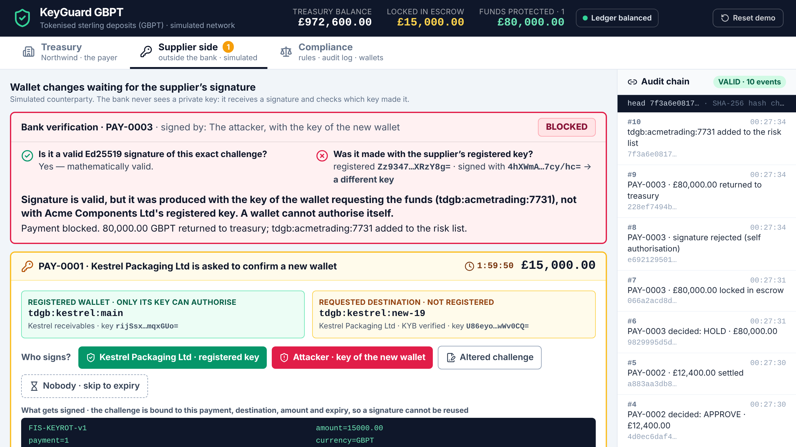
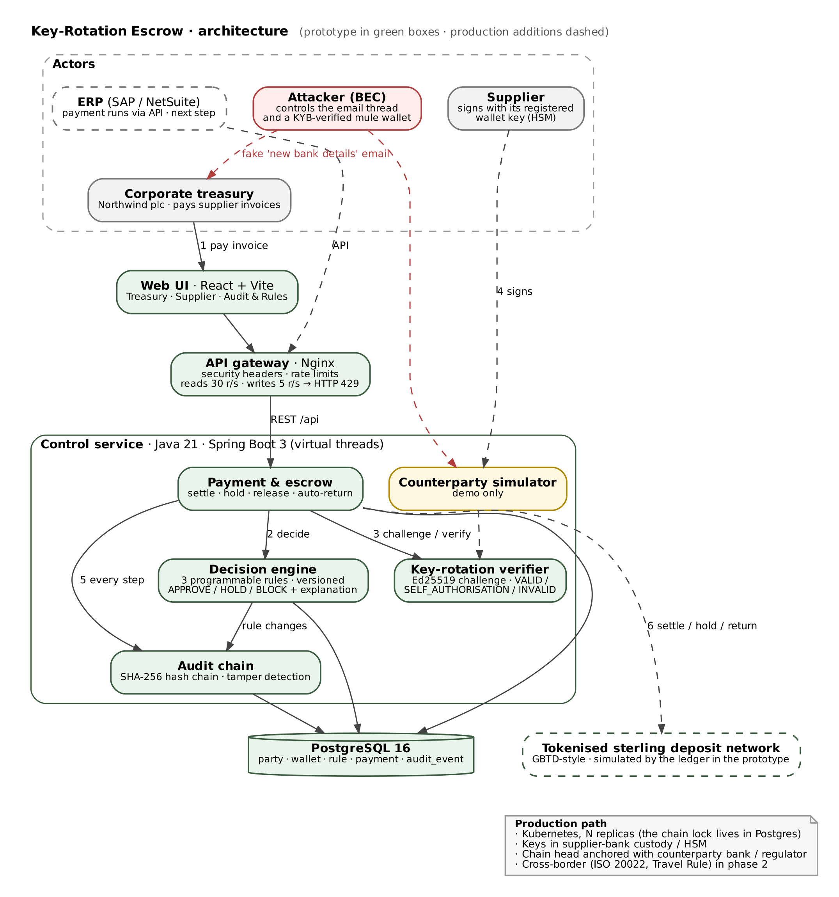

# KeyGuard GBPT — key-rotation escrow for tokenised sterling payments

FIS Digital Assets Hackathon 2026 · Challenge 1 · Digital Trust & Programmable Controls

A B2B payment in tokenised sterling deposits is instant and final. When an invoice arrives with "new bank details", the payer has no second chance. KeyGuard is a programmable control that sits between the payer's treasury and the network and decides every payment:

| Destination wallet | Outcome |
|---|---|
| The supplier's registered wallet | **Settled** at once. No friction. |
| Any other wallet | **Held in escrow** until the supplier authorises the change by signing a challenge with the key of its *registered* wallet (Ed25519). |
| …and the signature comes from the *new* wallet's key | Valid signature, wrong key: the mark of an impostor. **Blocked**, funds returned, wallet added to the risk list. |
| …and nobody signs | Funds **return automatically** when the escrow window ends. |
| A wallet on the risk list | **Blocked** before any money moves. |

Every decision is explained rule by rule. Every step is written to a SHA-256 hash-chained audit log that detects any edit to a past record.

A bank account cannot sign anything; a wallet can. That is what makes this control possible on tokenised deposits and impossible on account-based rails.

> Prototype: synthetic data, simulated network, demo keys. Scope: United Kingdom, B2B, tokenised sterling deposits (GBPT).



## Run

Requires Docker with Compose.

```bash
docker compose up -d --build
docker compose restart gateway        # after any backend rebuild: nginx keeps the old upstream address
```

Open **http://localhost:18080**. Present in Chrome, full screen (F11), 150 % zoom on a 1080p display.

Ports listen on `127.0.0.1` only. To reach the stack from another machine: `BIND_ADDR=0.0.0.0 docker compose up -d`.

| Service | Container | Host port |
|---|---|---|
| API gateway (nginx) — the only entry point | `fis-gateway` | 18080 |
| Control service (Java 21, Spring Boot 3.3) | `fis-backend` | 8081 (direct, for tests) |
| Web UI (React 19, Vite, Tailwind 3) | `fis-frontend` | 5173 |
| PostgreSQL 16 | `fis-db` | 15432 |

## Demo in two minutes

Click **Reset demo** twice first (it seeds one payment already in escrow).

| Step | Where | Action | What happens |
|---|---|---|---|
| 1 | Treasury | Pay *Brightwater Logistics* | Settled instantly |
| 2 | Treasury | Pay *Acme Components — "URGENT: please pay our new trading entity"* | Held: £80,000 leaves treasury but does not reach the new wallet |
| 3 | Supplier side | *Attacker · key of the new wallet* | Valid signature, different key → blocked, money back, wallet on the risk list |
| 4 | Treasury → Supplier side | Pay *Acme — moving to a new bank*, then *Acme Components Ltd · registered key* | Released; the new wallet becomes Acme's registered wallet |
| 5 | Supplier side | On PAY-0001: *Nobody · skip to expiry* | Money returns on its own |
| 6 | Terminal | `curl -X POST http://localhost:18080/api/demo/tamper` | The top bar turns red within two seconds: tampering detected at event #N |

Keys `1` `2` `3` switch tabs. Steps 2 and 4 can be paid together first; the Supplier side then resolves all three requests without leaving the tab.

Each invoice is paid once: a paid or held invoice cannot be sent again, and one that was blocked or returned can be retried. Retrying the "URGENT" invoice after step 3 is blocked at once, because its wallet is now on the risk list.

## Tests

```bash
python3 scripts/preflight.py           # everything below except the attack, then a clean reset -> GO / NO-GO
./scripts/smoke.sh --tamper            # golden path through the gateway            -> 20/20
python3 scripts/matrix.py --extra      # spec matrix T1–T17, T19 + regressions       -> 26/26
./scripts/attack.sh                    # 25 forged authorisations from another host -> ~11 pass (404), ~14 cut by the gateway (429)
docker run --rm -v "$PWD/backend":/app -w /app maven:3.9.6-eclipse-temurin-21-alpine mvn -q test   # 14 unit tests on fixed vectors
```

The matrix covers, among others: signature replay on another payment, three invalid signatures, idempotent retries, live rule changes, and 20 payments in parallel with the ledger conserved and the chain unforked.

## How it is built



- **Decision engine** (`rules/`) — three versioned rules evaluated on every payment: risk-list screening (block), unverified-wallet velocity (block), key-rotation escrow (hold). Rules are edited live; each change bumps the version and is audited.
- **Key-rotation verifier** (`crypto/`) — the challenge names the payment, both wallets, the amount, a nonce and an expiry, so a signature cannot be replayed or redirected. Verification uses the registered public key captured when the funds were held.
- **Audit chain** (`audit/`) — `hash = SHA-256(seq | type | entity | actor | time | payload | previous hash)`. The chain is re-verified on every state read.
- **Ledger and payments** (`ledger/`, `payments/`) — every money movement and its audit events commit in one transaction under a PostgreSQL advisory lock, so the chain cannot fork across replicas.
- **Gateway** (`gateway/nginx.conf`) — separate limits for reads (30 r/s) and writes (5 r/s), so a brute-force attempt is cut off without starving the dashboard.

The frozen contract is in [`docs/SPEC.md`](docs/SPEC.md); the data model in [`docs/data-model.png`](docs/data-model.png).

## Known limits

- The audit chain detects edits to past records. It does not stop someone with full database access from rewriting every hash, or from deleting the newest events. Next step: anchor the head hash outside the system and sign it in an HSM.
- A supplier that is fraudulent from day one is out of scope (onboarding KYB).
- The authorisation endpoint is unauthenticated in the prototype. In production it sits behind the supplier bank's channel and attempts are counted per submitter.
- A key rotated out still authorises escrows opened before the rotation. In production a rotation re-issues pending challenges.
- `/api/demo/**` and `/api/sim/**` are demo controls and counterparty simulation. They do not exist in production.

## Repository

```
backend/    Spring Boot control service (ledger, payments, rules, crypto, audit, api)
frontend/   React UI
gateway/    nginx configuration
scripts/    preflight.py · smoke.sh · matrix.py · attack.sh
docs/       SPEC.md (frozen contract), DEMO_RUNBOOK.md (operator's script for the live demo), diagrams, screenshots
```
